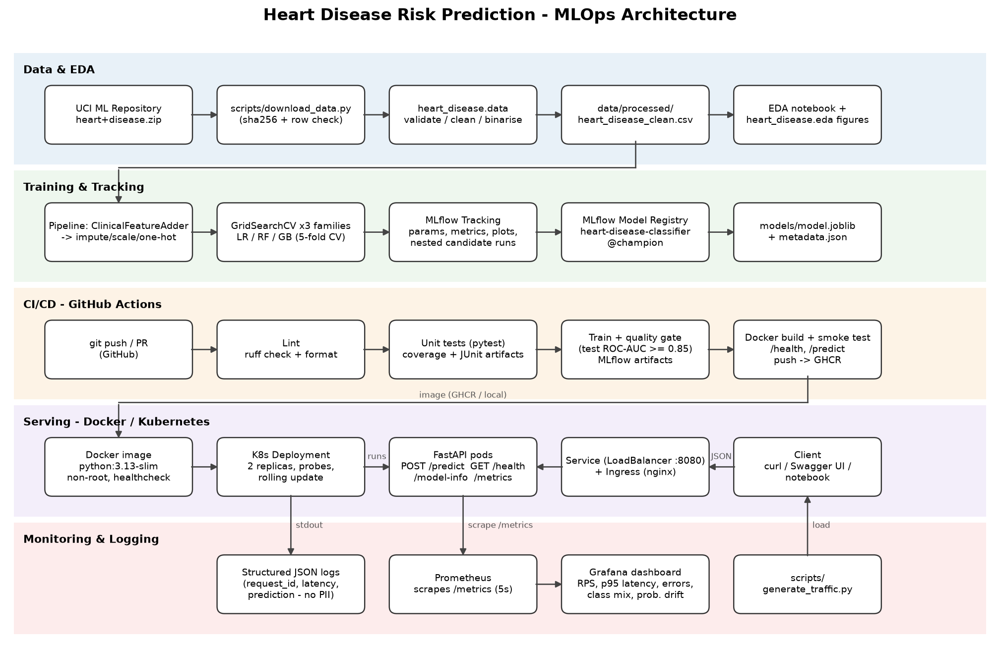

# Heart Disease Risk Prediction – End-to-End MLOps


This project builds a binary classifier that predicts whether a patient has heart disease from 13 clinical attributes in the [UCI Heart Disease dataset](https://archive.ics.uci.edu/dataset/45/heart+disease) (Cleveland subset, 303 patients). The model is served through a containerised FastAPI service. The project covers the full MLOps lifecycle:

| Stage | Implementation |
|---|---|
| Data acquisition & EDA | `scripts/download_data.py`, `heart_disease.data`, `heart_disease.eda`, `notebooks/01_eda.ipynb` |
| Feature engineering & models | sklearn `Pipeline` (custom `ClinicalFeatureAdder` → impute/scale/one-hot) with Logistic Regression, Random Forest and Gradient Boosting tuned by 5-fold `GridSearchCV` |
| Experiment tracking | MLflow tracking (SQLite backend) with nested runs, artifacts, signatures, and a model registry alias `@champion` |
| Packaging | `pyproject.toml` installable package, pinned `requirements.txt`, `models/model.joblib` + `metadata.json`, MLflow `pyfunc` model |
| CI/CD | GitHub Actions: lint → test → train (with quality gate) → Docker build + smoke test → push to GHCR |
| Serving | FastAPI `/predict`, `/health`, `/model-info`, `/metrics` in a non-root Docker image |
| Deployment | Kubernetes manifests (Namespace, Deployment, LoadBalancer Service, Ingress) via Kustomize |
| Monitoring | Structured JSON logs + Prometheus metrics + pre-provisioned Grafana dashboard |

**Champion model:** Logistic Regression (elastic-net, `C=1`, `l1_ratio=0.5`, `class_weight=balanced`)

| Metric | Value |
|---|---|
| CV ROC-AUC | 0.903 ± 0.024 |
| Test ROC-AUC | 0.957 |
| Test accuracy | 0.869 |
| Test recall | 0.929 |



---

## Repository layout

```
├── .github/workflows/ci-cd.yml    # CI/CD pipeline
├── data/
│   ├── raw/                       # downloaded UCI files (processed.cleveland.data, ...)
│   └── processed/heart_disease_clean.csv
├── k8s/                           # namespace, deployment, service (LoadBalancer), ingress, kustomization
├── models/                        # model.joblib, metadata.json, model_comparison.csv
├── monitoring/                    # prometheus.yml + Grafana provisioning & dashboard JSON
├── notebooks/                     # 01_eda, 02_model_training, 03_inference
├── reports/                       # REPORT.md, report .docx, figures/
├── screenshots/                   # deployment / CI / MLflow / monitoring screenshots
├── scripts/                       # download_data, generate_traffic, draw_architecture, build_report
├── src/heart_disease/             # the Python package
│   ├── config.py  data.py  features.py  eda.py  train.py  evaluate.py  predict.py
│   └── api/  main.py  schemas.py  monitoring.py
├── tests/                         # pytest unit + integration tests
├── Dockerfile  .dockerignore  docker-compose.yml
├── pyproject.toml  requirements.txt  requirements-serve.txt
└── sample_request.json  sample_request_low_risk.json
```

---

## 1. Local setup (reproducible)

Requires Python **3.13** (CI and Docker use the same version).

> **Windows PowerShell 5.1 users:** commands below are bash unless marked `powershell`. In PowerShell 5.1 use `;` instead of `&&`, and `curl.exe` (not `curl`, which is an alias for `Invoke-WebRequest`) with the file argument quoted: `-d "@sample_request.json"`.

```bash
python -m venv .venv
source .venv/bin/activate              # Linux/macOS
pip install -r requirements.txt        # pinned versions + editable install of the package
```

```powershell
python -m venv .venv
.\.venv\Scripts\Activate.ps1           # if blocked: Set-ExecutionPolicy -Scope Process Bypass
pip install -r requirements.txt
```

## 2. Data → EDA → training

```bash
python scripts/download_data.py        # downloads + verifies the UCI archive into data/raw/
python -m heart_disease.data           # cleans -> data/processed/heart_disease_clean.csv
python -m heart_disease.eda            # EDA figures -> reports/figures/
python -m heart_disease.train          # tunes 3 model families, logs to MLflow, saves models/
```

`python -m heart_disease.train --quick` runs a small grid in a few seconds. `--no-register` skips the model registry.

The notebooks in `notebooks/` contain the full narrative (EDA, model comparison, tuning heat-maps, threshold analysis, inference). They import the same package code.

### MLflow UI

```bash
mlflow ui --backend-store-uri sqlite:///mlflow.db --port 5000
# open http://127.0.0.1:5000  -> experiment "heart-disease-classification"
```

Each model family has a parent run with params, CV and test metrics, a confusion matrix, ROC/PR curves, feature importance, `cv_results.csv`, the logged dataset and the model (with its signature). Every grid candidate is a nested child run. The best model is registered as `heart-disease-classifier` with the alias `@champion`.

## 3. Tests and lint

```powershell
ruff check . ; ruff format --check .
pytest --cov=heart_disease
```

## 4. Run the API locally

```bash
uvicorn heart_disease.api.main:app --port 8000
# Swagger UI: http://127.0.0.1:8000/docs
```

| Method | Path | Purpose |
|---|---|---|
| POST | `/predict` | prediction, label, probability, confidence, risk band |
| GET | `/health` | liveness/readiness (503 if the model is not loaded) |
| GET | `/model-info` | model name, version, params and metrics |
| GET | `/metrics` | Prometheus metrics |

**curl (bash):**
```bash
curl -s -X POST http://127.0.0.1:8000/predict -H "Content-Type: application/json" -d @sample_request.json
```
**PowerShell:**
```powershell
Invoke-RestMethod -Method Post -Uri http://127.0.0.1:8000/predict -ContentType "application/json" -InFile sample_request.json
# or, with the real curl shipped with Windows:
curl.exe -s -X POST http://127.0.0.1:8000/predict -H "Content-Type: application/json" -d "@sample_request.json"
```
**Response:**
```json
{
  "prediction": 1,
  "label": "heart_disease",
  "probability_disease": 0.9964,
  "confidence": 0.9964,
  "risk_band": "high",
  "model_name": "logistic_regression",
  "model_version": "20261011104453",
  "request_id": "9d879ca9579c4df1beb28093335dd488"
}
```
Invalid input returns HTTP 422 with field-level errors. Examples: an unknown field, `cp=9`, or `age=300`.

## 5. Docker

```bash
docker build -t heart-disease-api:1.0.0 .
docker run -d --rm -p 8000:8000 --name heart-api heart-disease-api:1.0.0
curl -s -X POST http://localhost:8000/predict -H "Content-Type: application/json" -d @sample_request.json
docker stop heart-api
```

```powershell
docker build -t heart-disease-api:1.0.0 .
docker run -d --rm -p 8000:8000 --name heart-api heart-disease-api:1.0.0
curl.exe -s -X POST http://localhost:8000/predict -H "Content-Type: application/json" -d "@sample_request.json"
docker stop heart-api
```

The CI pipeline publishes the image to `ghcr.io/kknandi/heart-disease-api:latest`.

## 6. Kubernetes deployment

Tested target: **Docker Desktop → Settings → Kubernetes → Enable**. Minikube instructions are below.

```bash
docker build -t heart-disease-api:1.0.0 .     # image is used directly by the local cluster
kubectl apply -k k8s/
kubectl -n heart-disease rollout status deployment/heart-disease-api
kubectl -n heart-disease get all
curl -s -X POST http://localhost:8080/predict -H "Content-Type: application/json" -d @sample_request.json
```

PowerShell: replace the last line with
`curl.exe -s -X POST http://localhost:8080/predict -H "Content-Type: application/json" -d "@sample_request.json"`.

* **Service:** `LoadBalancer` on port 8080. Docker Desktop exposes it on `localhost:8080`.
* **Ingress (optional):** first install ingress-nginx by following the quick-start in the
  [ingress-nginx deploy guide](https://kubernetes.github.io/ingress-nginx/deploy/). Then browse to `http://heart-disease.localtest.me/docs`.
* **Minikube:** run `minikube image load heart-disease-api:1.0.0`, then `kubectl apply -k k8s/`, then run `minikube tunnel` in a separate terminal.
* **Cloud (GKE/EKS/AKS):** set `image:` in `k8s/deployment.yaml` to `ghcr.io/kknandi/heart-disease-api:latest`. The LoadBalancer then gets a public IP.
* **Clean up:** `kubectl delete -k k8s/`

The Deployment runs 2 replicas with a zero-downtime rolling update and startup/readiness/liveness probes on `/health`. It also sets CPU/memory requests and limits, uses a non-root read-only root filesystem, and carries Prometheus scrape annotations.

## 7. Monitoring & logging

```bash
docker compose up --build -d                  # API :8000, Prometheus :9090, Grafana :3000
python scripts/generate_traffic.py --n 300 --invalid-ratio 0.1
```

* **Grafana:** <http://localhost:3000> (admin / `admin`, or the value of `GRAFANA_ADMIN_PASSWORD`). The *Heart Disease API* dashboard is provisioned automatically. It shows request rate, p50/p95/p99 latency, 4xx/5xx rates, prediction class mix and mean predicted probability (a simple drift signal).
* **Prometheus:** <http://localhost:9090/targets>
* **Logs:** every request emits one JSON line with request id, path, status and latency, plus the predicted label and probability. No patient features are logged. View them with `docker compose logs -f api` or `kubectl -n heart-disease logs -l app.kubernetes.io/name=heart-disease-api -f`.
* **Kubernetes target:** to point Prometheus at the cluster service, use `python scripts/generate_traffic.py --url http://localhost:8080` and select `env=kubernetes` in Grafana.

## 8. CI/CD (GitHub Actions)

`.github/workflows/ci-cd.yml` runs on every push and pull request to `main`, and can be triggered manually:

1. **lint** – `ruff check` and `ruff format --check`.
2. **test** – `pytest` with coverage. Uploads JUnit and coverage HTML as the `test-reports` artifact.
3. **train** – downloads the data, then cleans it, runs EDA and trains. A **quality gate** fails the build if test ROC-AUC is below 0.85. Uploads the `model` and `mlflow-and-reports` artifacts.
4. **docker** – builds the image with the freshly trained model. It then runs a container, smoke-tests `/health` and `/predict`, and checks that bad input returns 422. Container logs and metrics are uploaded. On `main`, the image is pushed to GHCR.

Each job fails the pipeline on error. Results appear in the run summary.

## 9. Report

`reports/REPORT.md` is the source of the written report. After adding screenshots to `screenshots/`, build the Word version:

```bash
python scripts/build_report.py      # -> reports/MLOps_Assignment1_Report.docx
```

---

**Repository:** https://github.com/kknandi/heart-disease-mlops
