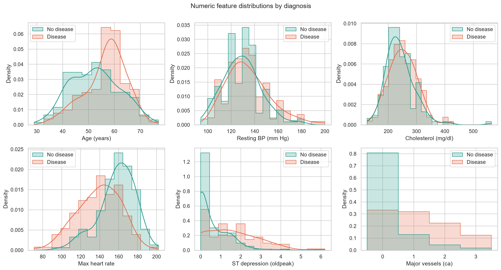
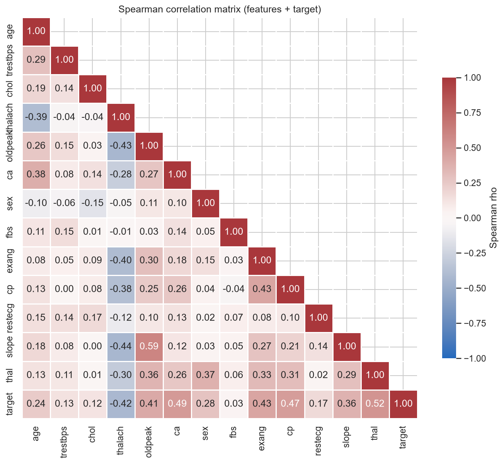
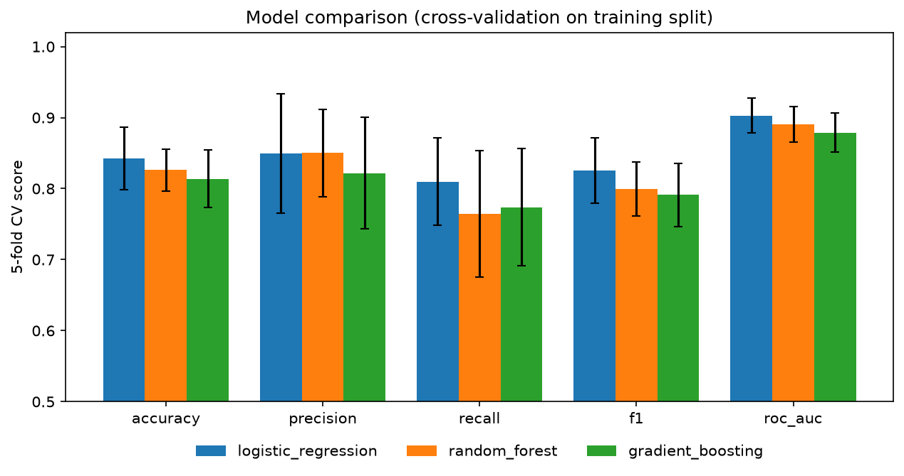
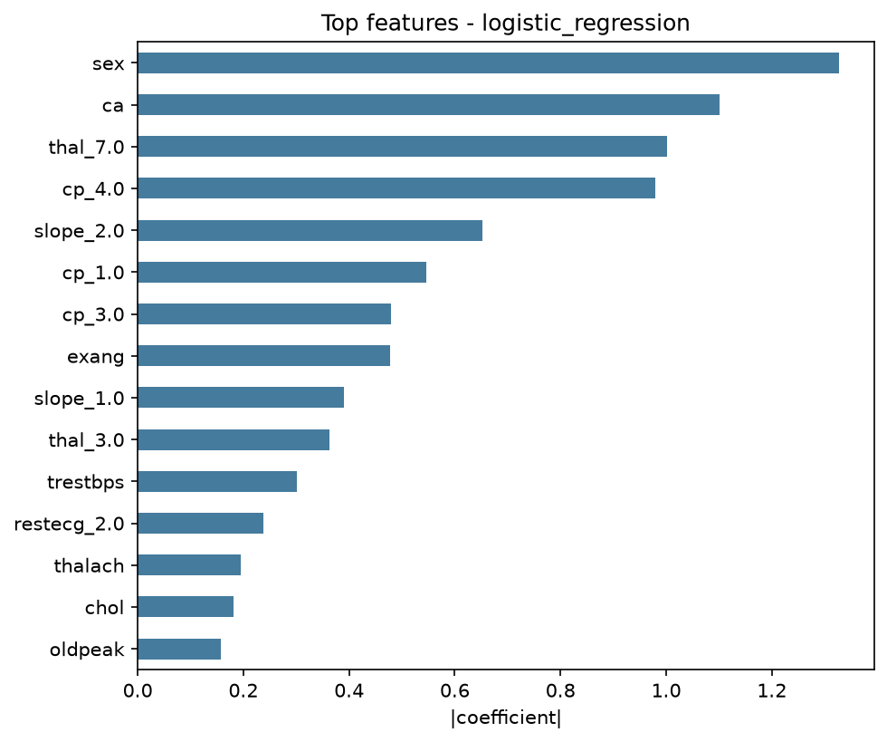
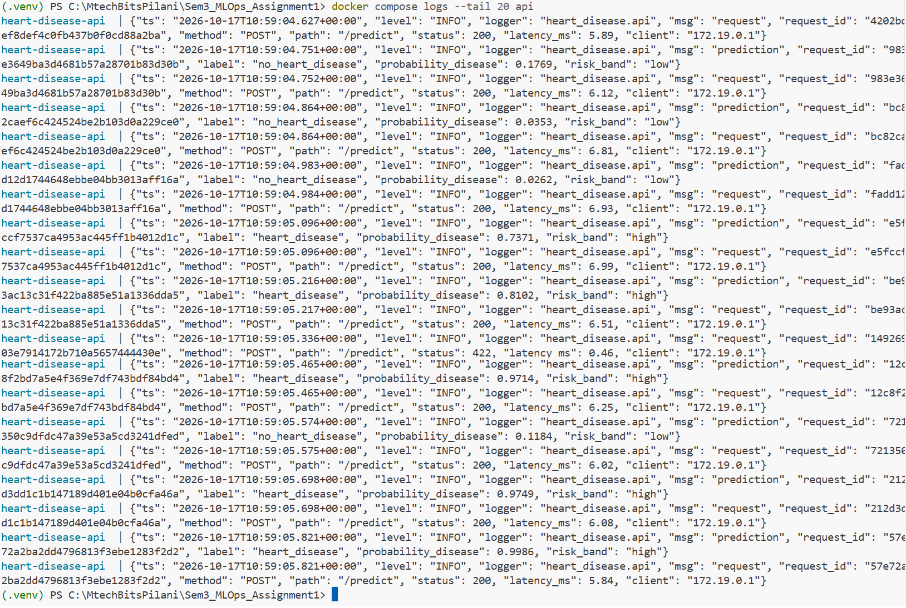

# Heart Disease Risk Prediction – End-to-End MLOps Pipeline

**Course:** MLOps – Assignment 1  
**Student:** <Your Name> (<BITS ID>)  
**Repository:** https://github.com/kalloln2007/heart-disease-mlops  
**Video:** <link to the demo video>  
**Date:** <submission date>

\pagebreak

## 1. Introduction and objectives

The aim of this project is a production-style ML system. Given 13 routinely collected clinical attributes, it predicts whether a patient has heart disease. The modelling problem is small: 303 patients and binary classification. The emphasis of the assignment is therefore on the **MLOps lifecycle** around the model:

* reproducible data acquisition and cleaning;
* systematic model comparison with cross-validation;
* experiment tracking and a model registry;
* packaging for reproducibility;
* automated CI/CD with quality gates;
* containerised serving;
* Kubernetes deployment;
* monitoring and logging.

Table 1 maps each assignment task to its implementation.

| Task | Deliverable in repository |
|---|---|
| 1. Data acquisition & EDA | `scripts/download_data.py`, `src/heart_disease/data.py`, `src/heart_disease/eda.py`, `notebooks/01_eda.ipynb` |
| 2. Feature engineering & models | `src/heart_disease/features.py`, `src/heart_disease/train.py`, `notebooks/02_model_training.ipynb` |
| 3. Experiment tracking | MLflow (SQLite store, nested runs, artifacts, registry alias `@champion`) |
| 4. Packaging & reproducibility | `pyproject.toml`, pinned `requirements.txt`, `models/model.joblib` + `metadata.json`, MLflow model |
| 5. CI/CD & testing | `tests/` (42 tests), `.github/workflows/ci-cd.yml` |
| 6. Containerisation | `Dockerfile`, FastAPI app in `src/heart_disease/api/` |
| 7. Production deployment | `k8s/` (Namespace, Deployment, LoadBalancer Service, Ingress, Kustomize) |
| 8. Monitoring & logging | JSON logs, Prometheus `/metrics`, Grafana dashboard (`monitoring/`, `docker-compose.yml`) |
| 9. Documentation | this report, `README.md`, `screenshots/` |

## 2. System architecture


The system has five layers (Figure 1):

1. **Data & EDA** – a download script fetches the official UCI archive and verifies its row count and SHA-256 hash. A cleaning module validates every column and writes a versioned CSV.
2. **Training & tracking** – one sklearn `Pipeline` holds feature engineering, preprocessing and the estimator. Three model families are tuned with `GridSearchCV`. MLflow records every candidate. The best model is registered and exported.
3. **CI/CD** – GitHub Actions runs lint, tests, training with a quality gate, and a Docker build with a smoke test on every push.
4. **Serving** – a FastAPI service is packaged in a slim, non-root Docker image. It is deployed to Kubernetes with two replicas behind a LoadBalancer service and an optional Ingress.
5. **Monitoring** – each request produces a structured JSON log line. Prometheus scrapes the `/metrics` endpoint and Grafana visualises traffic, latency, errors and the distribution of predictions.

The key design decision is that **one Python package (`heart_disease`) is the single source of truth**. The notebooks, the training CLI, the CI pipeline, the tests and the API all import the same cleaning and feature code. This prevents training/serving skew.

## 3. Data acquisition and exploratory data analysis

### 3.1 Acquisition

`scripts/download_data.py` downloads `heart+disease.zip` from the UCI Machine Learning Repository. If that fails, it falls back to the legacy URL. It extracts the processed files into `data/raw/`, asserts that the Cleveland file has 303 rows, and logs its SHA-256 so that a changed upstream file is detected. It uses only the standard library, so it runs before any dependencies are installed. A `--from-zip` option supports offline use.

### 3.2 Data quality and cleaning

The raw file has no header and encodes missing values as `?`. The original target `num` takes values 0–4: 0 means no disease and 1–4 are increasing severity. `heart_disease.data.clean_data()` applies documented rules:

| Step | Rule | Rationale |
|---|---|---|
| Type coercion | all columns to numeric; malformed → NaN | robust to bad input |
| Range validation | e.g. cholesterol outside 80–700 mg/dl → NaN | other UCI sites encode *unknown* as 0 |
| Category validation | unknown codes (e.g. `cp=9`) → NaN | protects the one-hot encoder |
| Target | `num > 0` → 1 (disease), else 0 | binary task; severity classes 1–4 are too small on their own |
| Duplicates / missing target | dropped | – |

Only six cells are missing: `ca` (4) and `thal` (2). They are **not** imputed during cleaning. Instead, imputation happens inside the model pipeline and is fitted on training folds only. This avoids leakage and guarantees identical treatment at inference time, when the API also accepts missing `ca`/`thal`.

### 3.3 Exploratory analysis


The classes are close to balanced: 164 patients without disease (54 %) and 139 with disease (46 %). No resampling is required. Splits are stratified, and the evaluation reports ROC-AUC, precision and recall rather than accuracy alone.






Key findings:

* **Strong signals:**
  * asymptomatic chest pain (`cp=4`)
  * reversible thallium defect (`thal=7`)
  * number of major vessels coloured by fluoroscopy (`ca`)
  * exercise-induced angina (`exang`)
  * ST depression (`oldpeak`)
  * a *low* maximum heart rate (`thalach`)
* **Weak signals:** cholesterol, fasting blood sugar and resting ECG show little univariate separation.
* Spearman correlation was used because several attributes are ordinal or skewed. No pair of features is so strongly correlated that it would destabilise a regularised linear model.


## 4. Feature engineering and model development

### 4.1 Preprocessing pipeline

All transformations live in a single sklearn `Pipeline`, which is fitted inside each CV fold:

1. **`ClinicalFeatureAdder`** – a custom transformer that adds two domain features:
   * `hr_achievement = thalach / (220 − age)`. This is the fraction of the age-predicted maximum heart rate reached during exercise (chronotropic response). It removes the age confound visible in Figure 6.
   * `risk_flag_count`. This counts the binary risk flags that are present: fasting blood sugar > 120, exercise angina, cholesterol > 240, and resting BP ≥ 140.
2. **`ColumnTransformer`** with three branches:
   * numeric (+ derived) features → median imputation → `StandardScaler`;
   * binary features → most-frequent imputation;
   * nominal features (`cp`, `restecg`, `slope`, `thal`) → most-frequent imputation → `OneHotEncoder(handle_unknown="ignore")`.

   This yields 24 model inputs.
3. **Estimator.**

Because the whole chain is one serialisable object, the API receives raw clinical values and no preprocessing code is duplicated.

### 4.2 Baseline comparison

The data were split 80/20 with stratification (242 training and 61 test patients; `random_state=42`). Six candidates were first compared with 5-fold stratified CV on the training set, all using default hyper-parameters:

| Model | Accuracy | Precision | Recall | F1 | ROC-AUC |
|---|---|---|---|---|---|
| Dummy (majority) | 0.541 | 0.000 | 0.000 | 0.000 | 0.500 |
| Logistic Regression | 0.835 | 0.861 | 0.774 | 0.811 | **0.900** |
| SVC (RBF) | 0.797 | 0.823 | 0.729 | 0.768 | 0.873 |
| KNN (k=15) | 0.785 | 0.824 | 0.684 | 0.745 | 0.857 |
| Random Forest | 0.797 | 0.806 | 0.738 | 0.767 | 0.875 |
| Gradient Boosting | 0.802 | 0.800 | 0.757 | 0.777 | 0.865 |

Three families went forward to tuning: Logistic Regression (linear), Random Forest (bagging) and Gradient Boosting (boosting).

### 4.3 Hyper-parameter tuning and selection

Each family was tuned with `GridSearchCV` (5-fold stratified CV, `refit="roc_auc"`). The grids were:

* **Logistic Regression** (saga, elastic-net) – 24 candidates:
  * C ∈ {0.01, 0.1, 1, 10}
  * l1_ratio ∈ {0, 0.5, 1}
  * class_weight ∈ {None, balanced}
* **Random Forest** – 24 candidates:
  * n_estimators ∈ {200, 500}
  * max_depth ∈ {None, 4, 8}
  * min_samples_leaf ∈ {1, 4}
  * max_features ∈ {sqrt, 0.5}
* **Gradient Boosting** – 16 candidates:
  * n_estimators ∈ {100, 300}
  * learning_rate ∈ {0.03, 0.1}
  * max_depth ∈ {2, 3}
  * subsample ∈ {0.8, 1.0}

**Selection rule:** the model with the highest mean CV ROC-AUC wins. ROC-AUC does not depend on the decision threshold and is robust to the mild class imbalance. The test set is only used for the final report.

| Model | CV ROC-AUC | Test ROC-AUC | Test accuracy | Test precision | Test recall | Test F1 |
|---|---|---|---|---|---|---|
| **Logistic Regression** (C=1, l1_ratio=0.5, balanced) | **0.903 ± 0.024** | **0.957** | 0.869 | 0.813 | 0.929 | 0.867 |
| Random Forest | 0.890 ± 0.025 | 0.944 | 0.885 | 0.862 | 0.893 | 0.877 |
| Gradient Boosting | 0.879 ± 0.027 | 0.955 | 0.902 | 0.867 | 0.929 | 0.897 |




**Discussion.** Gradient Boosting reaches a slightly higher test accuracy. However, 61 test patients is a small sample: one patient is worth 1.6 percentage points of accuracy, so the test differences are within noise. Cross-validation over 242 patients is the more reliable estimate, and there the regularised logistic regression is best and also the most stable. It is also the most interpretable model, because each coefficient maps to a clinical attribute (Figure 10). That matters in a medical setting. It was therefore selected as the **champion**.




**Threshold analysis.** In screening, a missed disease (false negative) costs more than a false alarm. The table shows the trade-off on the test set. The service uses 0.5, which gives recall 0.93. The threshold is stored in `metadata.json`, so it can be lowered without retraining.

| Threshold | Accuracy | Precision | Recall | F1 |
|---|---|---|---|---|
| 0.3 | 0.820 | 0.730 | 0.964 | 0.831 |
| 0.4 | 0.852 | 0.771 | 0.964 | 0.857 |
| **0.5** | **0.869** | **0.812** | **0.929** | **0.867** |
| 0.6 | 0.869 | 0.833 | 0.893 | 0.862 |
| 0.7 | 0.902 | 0.893 | 0.893 | 0.893 |

## 5. Experiment tracking (MLflow)

`heart_disease.train` logs to an MLflow tracking server backed by SQLite (`mlflow.db`), with file artifacts under `mlruns/`. Each training run creates the following:

* **A parent run per model family** containing:
  * the best hyper-parameters
  * CV mean and standard deviation for accuracy, precision, recall, F1 and ROC-AUC
  * test metrics
  * the training dataset, logged with `mlflow.log_input`
  * artifacts: confusion matrix, ROC/PR curves, feature importance, full `cv_results.csv`, a classification report, and the model
* **The logged model** has an inferred **signature** and an **input example**. The package code is attached (`code_paths`) and the serving requirements are pinned, so `mlflow models serve` works without the repository.
* **Nested child runs** – one for each of the 64 grid candidates, with that candidate's parameters and CV scores. The search can therefore be sorted and compared in the UI.
* **A "model-selection" run** that logs the comparison table and figures, and the name of the winning model.
* **Model Registry** – the champion is registered as `heart-disease-classifier`, and the alias `@champion` points to the newest version. `notebooks/03_inference.ipynb` loads `models:/heart-disease-classifier@champion` and checks that its predictions equal those of the exported joblib file.


## 6. Packaging and reproducibility

* **Installable package:** the code is installed with `pip install -e .`, configured in `pyproject.toml`. The same file holds the ruff, pytest and coverage settings.
* **Pinned environments:**
  * `requirements.txt` – full development environment, with exact versions.
  * `requirements-serve.txt` – minimal runtime used by Docker and by the MLflow model.
* **Determinism:** `RANDOM_STATE=42` is used for the split, the CV folds and the estimators. The data hash is recorded.
* **Model artefacts:**
  * `models/model.joblib` – the complete pipeline, including preprocessing.
  * `models/metadata.json` – model name, version timestamp, best params, CV and test metrics, feature list, decision threshold, MLflow run id, registry version, data SHA-256, and the sklearn and Python versions.
  * The same model is also available in MLflow `pyfunc` format.
* **One-command rebuild:** the steps below regenerate every artefact from scratch. CI runs exactly these steps.
  1. `python scripts/download_data.py`
  2. `python -m heart_disease.data`
  3. `python -m heart_disease.eda`
  4. `python -m heart_disease.train`

## 7. CI/CD pipeline and automated testing

### 7.1 Tests

`tests/` contains 42 pytest tests. They run in about 10 s and cover 78 % of the package's lines; the plotting-only `eda.py` module is exercised by the notebook and the CI train job instead.

| File | Covers |
|---|---|
| `test_data.py` | parsing `?` as missing, a missing file, binarising the target, range/category validation, dropping duplicates and rows without a target, rejecting missing columns |
| `test_features.py` | the derived feature formulas, tolerance of missing values, no NaNs after preprocessing, standardisation, unseen categories, output feature names |
| `test_model.py` | metric computation, every model family learning a synthetic signal, feature importance for linear and tree models, grid definitions, the prediction output contract, a missing-model error, risk bands, and an **end-to-end quick training run** against a temporary MLflow store (runs, artifacts, registry) |
| `test_api.py` | `/health`, `/model-info`, `/predict` returning a prediction and confidence, optional fields, `X-Request-ID` propagation, 422 on invalid values / extra or missing fields, `/metrics` counters, and a 503 when no model is loaded |

### 7.2 GitHub Actions workflow

The workflow `.github/workflows/ci-cd.yml` runs on every push and pull request to `main`, and can also be triggered manually. Its jobs run in sequence; if a job fails, every job after it is skipped.

| Job | Steps | Artifacts |
|---|---|---|
| **lint** | `ruff check`, `ruff format --check` | – |
| **test** | pytest with coverage, JUnit XML; results go to the job summary | `test-reports` (JUnit + HTML coverage) |
| **train** | download → clean → EDA → train; **quality gate** fails the build if test ROC-AUC < 0.85; a metrics table is written to the run summary | `model`, `mlflow-and-reports` (MLflow store, figures, training log) |
| **docker** | build the image with the freshly trained model, run it, wait for `/health`, smoke-test `/predict`, assert that invalid input returns 422; on `main`, push to `ghcr.io/kalloln2007/heart-disease-api:{sha,latest}` | `docker-smoke-test` (metrics + container logs) |

Pip caching and `concurrency` cancellation keep runs short. The image is pushed with the built-in `GITHUB_TOKEN`, so no secrets are stored.


## 8. Model containerisation

The FastAPI application (`src/heart_disease/api/`) exposes these endpoints:

| Endpoint | Description |
|---|---|
| `POST /predict` | Accepts the 13 clinical attributes as JSON and returns the prediction, label, probability of disease, **confidence**, a risk band (low/moderate/high), and the model name/version and request id. |
| `GET /health` | Returns 200 when the model is loaded and 503 otherwise. Used by the Docker HEALTHCHECK and the Kubernetes probes. |
| `GET /model-info` | Returns the model metadata. |
| `GET /metrics` | Prometheus exposition format. |
| `/docs` | Interactive Swagger UI. |

**Input validation.** Pydantic validates every field's type and clinical range and restricts categorical fields to their allowed codes with `Literal`. Unknown fields are rejected (`extra="forbid"`). Invalid requests receive HTTP 422 with field-level messages and never reach the model.

**Dockerfile.** The image is built in these steps:

1. Start from `python:3.13-slim`.
2. Install only `requirements-serve.txt`, then the package with `--no-deps`.
3. Copy only `model.joblib` and `metadata.json`.
4. Switch to an unprivileged user (uid 10001).
5. Declare a `HEALTHCHECK` on `/health`.
6. Start `uvicorn` with the port configurable through `PORT`.

`.dockerignore` keeps data, tests, notebooks and the MLflow store out of the build context.

```
docker build -t heart-disease-api:1.0.0 .
docker run --rm -p 8000:8000 heart-disease-api:1.0.0
curl -X POST http://localhost:8000/predict -H "Content-Type: application/json" -d @sample_request.json
{"prediction":1,"label":"heart_disease","probability_disease":0.9964,"confidence":0.9964,
 "risk_band":"high","model_name":"logistic_regression","model_version":"20261011104453",...}
```


## 9. Production deployment (Kubernetes)

The manifests in `k8s/` are applied with `kubectl apply -k k8s/`. They were tested on Docker Desktop's built-in Kubernetes; minikube and cloud variants are described in the README.

* **Namespace** `heart-disease`, which isolates the application's resources.
* **Deployment**:
  * 2 replicas.
  * Rolling update with `maxUnavailable: 0`, so deployments cause no downtime.
  * **Probes:**
    * a startup probe, which gives the model time to load;
    * a readiness probe, so a pod receives traffic only after the model has loaded;
    * a liveness probe, which restarts a hung pod.
  * CPU and memory requests and limits.
  * Hardened security context: non-root user, read-only root filesystem, all capabilities dropped, a `RuntimeDefault` seccomp profile, and `/tmp` mounted as an `emptyDir`.
  * Prometheus scrape annotations.
* **Service** of type `LoadBalancer` on port 8080. Docker Desktop maps it to `localhost:8080`; in the cloud it receives a public IP.
* **Ingress** (nginx class) for host `heart-disease.localtest.me`. This hostname resolves to 127.0.0.1, so no hosts-file edit is needed.


## 10. Monitoring and logging

**Logging.** A custom `JsonFormatter` writes one JSON object per line to stdout, which `docker logs`, `kubectl logs` and log shippers such as Fluent Bit, Loki or CloudWatch can consume. An HTTP middleware does three things for each request:

* It assigns or propagates an `X-Request-ID` (validated against a regex to prevent log injection).
* It times the request.
* It logs the method, path, status and latency.

Predictions log only the output label, probability and risk band. **Patient features are not logged**, which keeps personal health information out of logs.

**Metrics.** `prometheus_client` exposes the following:

| Metric | Type | Purpose |
|---|---|---|
| `api_requests_total{method,endpoint,status_code}` | Counter | traffic and error rates |
| `api_request_duration_seconds` | Histogram | p50/p95/p99 latency |
| `api_requests_in_progress` | Gauge | concurrency |
| `model_predictions_total{label}` | Counter | predicted class mix |
| `model_prediction_probability` | Histogram | output distribution (drift signal) |
| `model_prediction_errors_total` | Counter | inference failures |
| `model_loaded`, `model_info` | Gauge, Info | model availability and version |

The endpoint label uses the route template rather than the raw path, which prevents cardinality explosion.

**Dashboard.** `docker compose up` starts the API, Prometheus (scrape interval 5 s) and Grafana. Grafana is provisioned automatically with the data source and the *Heart Disease API* dashboard. The dashboard has 10 panels:

* model up
* total predictions
* requests per second
* 4xx and 5xx percentages
* requests by endpoint
* latency percentiles
* predictions by class
* mean predicted probability
* the probability distribution

An `env` variable switches between the docker-compose and Kubernetes targets. `scripts/generate_traffic.py` replays real patients from the dataset and injects a configurable share of invalid requests, so that the error panels show data.




## 11. Conclusions and future work

The project delivers a reproducible, tested and monitored ML service. Raw UCI data becomes a registered, containerised model running on Kubernetes, and every step is automated in CI. The regularised logistic regression achieves a CV ROC-AUC of 0.90 and a test ROC-AUC of 0.96, with 93 % recall at the default threshold, while remaining fully interpretable.

**Limitations and future work:**

* **Data:** 303 patients from one hospital is a small and dated cohort. External validation on the Hungarian, Swiss and VA subsets would test whether the model generalises.
* **Calibration:** the threshold and the probability calibration (Platt or isotonic) should be tuned with clinicians, using an explicit cost for false negatives.
* **Drift:** add drift detection on the inputs (e.g. Evidently, or a PSI computed in a sidecar) and alerting rules in Prometheus Alertmanager.
* **Automation:** add continuous deployment to a cloud cluster (GitOps with Argo CD) with canary rollouts, and scheduled retraining that promotes a model only if it beats the current `@champion`.
* **Security:** sign images and generate an SBOM (cosign/syft), and add an API key or OAuth to `/predict`.

## Appendix A – How to reproduce

```
git clone https://github.com/kalloln2007/heart-disease-mlops && cd heart-disease-mlops
python -m venv .venv && .venv\Scripts\activate          # Linux: source .venv/bin/activate
pip install -r requirements.txt
python scripts/download_data.py && python -m heart_disease.data && python -m heart_disease.train
pytest
docker build -t heart-disease-api:1.0.0 . && kubectl apply -k k8s/
curl -X POST http://localhost:8080/predict -H "Content-Type: application/json" -d @sample_request.json
```

## Appendix B – API access

* **Local / Docker:** `http://localhost:8000` (Swagger UI at `/docs`)
* **Kubernetes:** `http://localhost:8080` (LoadBalancer) or `http://heart-disease.localtest.me` (Ingress)
* **Image:** `ghcr.io/kalloln2007/heart-disease-api:latest`
