# Heart Disease Risk Prediction – End-to-End MLOps Pipeline

**Course:** MLOps (AIMLCZG523) – Assignment 1  
**Student:** Kallol Kumar Nandi (2025CT05010)  
**Repository:** https://github.com/kknandi/heart-disease-mlops  
**Video:** https://drive.google.com/file/d/1fALknWjPBK3YqliuhAVuLQssrfQERzV6/view?usp=drive_link  
**Supporting document:** `reports/MLOps_Assignment1_Supporting_Document.docx` (full tables, test inventory and all screenshots)  
**Date:** 18-Oct-2026

## 1. Summary

The project predicts heart disease from 13 clinical attributes of the UCI Heart Disease (Cleveland) dataset: 303 patients, binary target. It covers the whole lifecycle:

* reproducible data download and cleaning;
* cross-validated model selection;
* MLflow tracking and a model registry;
* a GitHub Actions pipeline with a quality gate;
* a FastAPI service in Docker;
* a Kubernetes deployment;
* Prometheus/Grafana monitoring.

The champion model, an elastic-net logistic regression, reaches **CV ROC-AUC 0.903** and **test ROC-AUC 0.957**, with **93 % recall**.

| Task | Implementation in the repository |
|---|---|
| 1. Data & EDA | `scripts/download_data.py`, `heart_disease.data`, `heart_disease.eda`, `notebooks/01_eda.ipynb` |
| 2. Features & models | `heart_disease.features`, `heart_disease.train`, `notebooks/02_model_training.ipynb` |
| 3. Experiment tracking | MLflow: parent and nested runs, artifacts, registry alias `@champion` |
| 4. Packaging | `pyproject.toml`, pinned `requirements.txt`, `models/model.joblib` + `metadata.json`, MLflow model |
| 5. CI/CD & tests | `tests/` (42 pytest tests), `.github/workflows/ci-cd.yml` |
| 6. Container | `Dockerfile`, FastAPI app `src/heart_disease/api/` |
| 7. Deployment | `k8s/`: Namespace, Deployment, LoadBalancer Service, Ingress |
| 8. Monitoring | JSON logs, `/metrics`, Prometheus + Grafana (`monitoring/`, `docker-compose.yml`) |

## 2. Architecture

{width=6.4}

There are five layers:

1. **Data:** a verified download and a cleaning module.
2. **Training:** one sklearn pipeline, tracked in MLflow.
3. **CI/CD:** GitHub Actions.
4. **Serving:** Docker and Kubernetes.
5. **Monitoring:** Prometheus and Grafana.

The key decision is that a single package (`heart_disease`) is imported by the notebooks, the training CLI, the tests, CI and the API, so training and serving cannot diverge.

## 3. Setup and installation

Requires Python 3.13 and Docker Desktop (with Kubernetes enabled). From the repository root:

```
python -m venv .venv ; .\.venv\Scripts\Activate.ps1
pip install -r requirements.txt
python scripts/download_data.py ; python -m heart_disease.data ; python -m heart_disease.eda ; python -m heart_disease.train
pytest --cov=heart_disease
docker build -t heart-disease-api:1.0.0 . ; kubectl apply -k k8s/
curl.exe -s -X POST http://localhost:8080/predict -H "Content-Type: application/json" -d "@sample_request.json"
```

**API access (local):**

* Docker: `http://localhost:8000` (Swagger UI at `/docs`).
* Kubernetes: `http://localhost:8080`.
* The CI pipeline publishes the image as `ghcr.io/kknandi/heart-disease-api:latest`.

## 4. Data acquisition and EDA

**Acquisition.** `download_data.py` fetches the official UCI archive, extracts it into `data/raw/`, and checks that the file has 303 rows and the expected SHA-256 hash, so a changed upstream file is detected.

**Cleaning.** `clean_data()` applies these rules:

* `?` is read as missing.
* Every column is converted to a number.
* Out-of-range values and unknown category codes are set to missing.
* The target is binarised: `num > 0` becomes 1.
* Duplicates are dropped.

Only 6 cells are missing (`ca`: 4, `thal`: 2). They are imputed **inside** the model pipeline, so the imputer is fitted on training folds only. This avoids leakage and handles missing values identically at inference time.

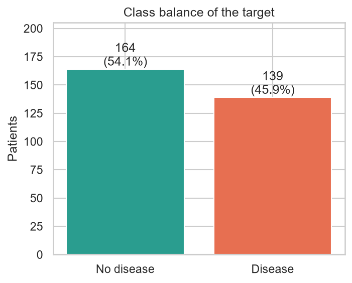 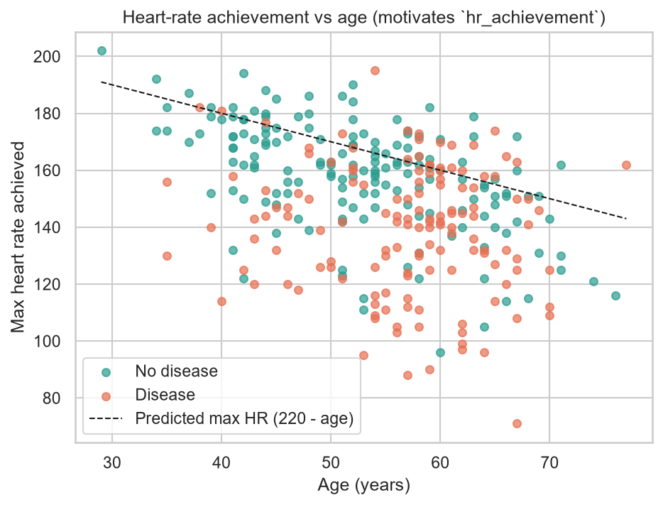

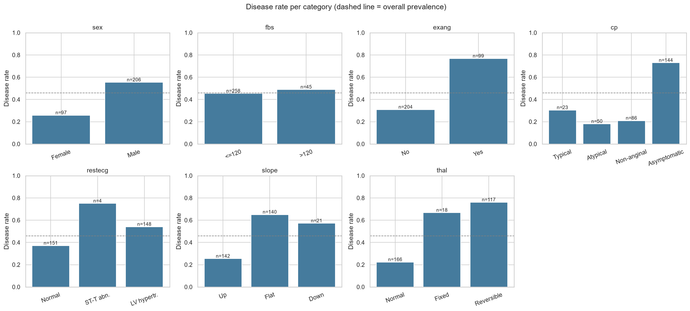{width=6.4}

**Findings:**

* **Classes are near-balanced:** 164 patients without disease (54 %) and 139 with it (46 %). Splits are therefore stratified, and the evaluation uses ROC-AUC, precision and recall rather than accuracy alone.
* **Strongest signals:**
  * asymptomatic chest pain (`cp=4`)
  * reversible thallium defect (`thal=7`)
  * number of major vessels (`ca`)
  * exercise angina (`exang`)
  * ST depression (`oldpeak`)
  * low maximum heart rate (`thalach`)
* **Weak signals:** cholesterol, fasting sugar and resting ECG.
* **Age confound:** maximum heart rate falls with age (Figure 3). This motivated an age-adjusted feature.

Histograms and the correlation heat-map are in the supporting document.

## 5. Feature engineering and model development

**Pipeline.** One sklearn `Pipeline` holds every step and is fitted inside each CV fold:

1. A custom `ClinicalFeatureAdder` adds two features:
   * `hr_achievement = thalach / (220 − age)`, the share of the age-predicted maximum heart rate reached during exercise;
   * `risk_flag_count`, the number of risk flags present: fasting sugar > 120, exercise angina, cholesterol > 240, resting BP ≥ 140.
2. A `ColumnTransformer` encodes the columns:
   * numeric features: median imputation, then `StandardScaler`;
   * binary features: most-frequent imputation;
   * `cp`, `restecg`, `slope`, `thal`: most-frequent imputation, then one-hot encoding.

   This gives 24 inputs.
3. The classifier.

**Selection process.**

* The data were split 80/20 with stratification: 242 training and 61 test patients.
* A baseline screen of six models with default settings (dummy, LR, SVC, KNN, RF, GB) showed logistic regression already strongest (CV ROC-AUC 0.900).
* Three families were then tuned with `GridSearchCV` (5-fold stratified CV, refit on ROC-AUC):
  * **Logistic regression** (24 candidates): C × l1_ratio × class_weight.
  * **Random forest** (24 candidates): n_estimators × max_depth × min_samples_leaf × max_features.
  * **Gradient boosting** (16 candidates): n_estimators × learning_rate × max_depth × subsample.
* The model with the best **mean CV ROC-AUC** wins. The test set is used only for reporting.

| Model (best params) | CV ROC-AUC | Test ROC-AUC | Accuracy | Precision | Recall | F1 |
|---|---|---|---|---|---|---|
| **Logistic Regression** (C=1, l1_ratio=0.5, balanced) | **0.903 ± 0.024** | **0.957** | 0.869 | 0.813 | 0.929 | 0.867 |
| Random Forest | 0.890 ± 0.025 | 0.944 | 0.885 | 0.862 | 0.893 | 0.877 |
| Gradient Boosting | 0.879 ± 0.027 | 0.955 | 0.902 | 0.867 | 0.929 | 0.897 |

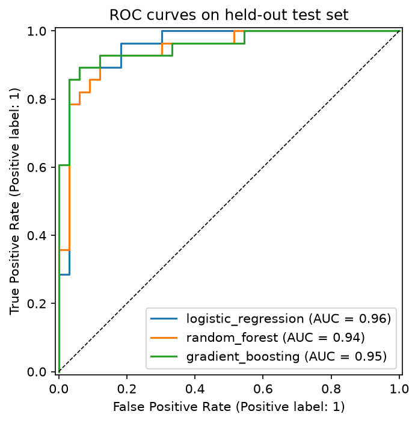 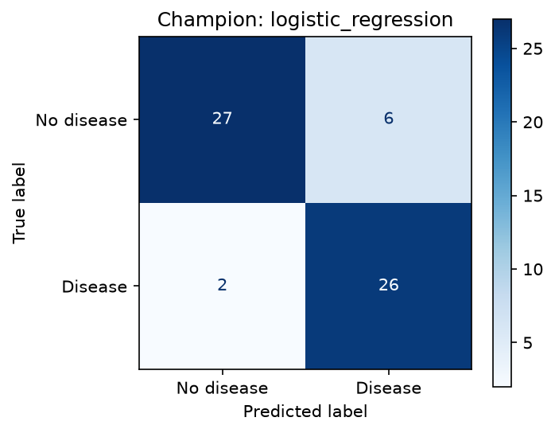

**Choice.** Gradient boosting has slightly higher test accuracy. However, with 61 test patients one patient changes accuracy by 1.6 points, so that gap is within noise. Cross-validation is the more reliable comparison, and there logistic regression is best and most stable. It is also interpretable, because each coefficient maps to a clinical attribute, which matters in a medical setting. The decision threshold (0.5) is stored in `metadata.json`. The supporting document shows the trade-off between 0.3 and 0.7.

## 6. Experiment tracking (MLflow)

`heart_disease.train` logs to an MLflow store (SQLite plus `mlruns/`), structured as follows:

* **A parent run per model family**, which logs:
  * the best parameters;
  * CV mean ± std and test values for accuracy, precision, recall, F1 and ROC-AUC;
  * the training dataset;
  * artifacts: confusion matrix, ROC/PR curves, feature importance, `cv_results.csv`, a classification report, and the model with its signature and input example.
* **64 nested child runs**, one per grid candidate.
* **A model-selection run**, which logs the comparison table and figures.
* **The registry:** the champion is registered as `heart-disease-classifier` with alias **@champion**. `notebooks/03_inference.ipynb` loads it from the registry and confirms its predictions match the exported `model.joblib`.

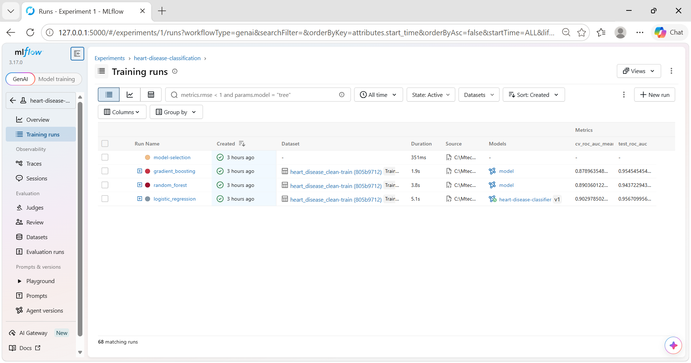 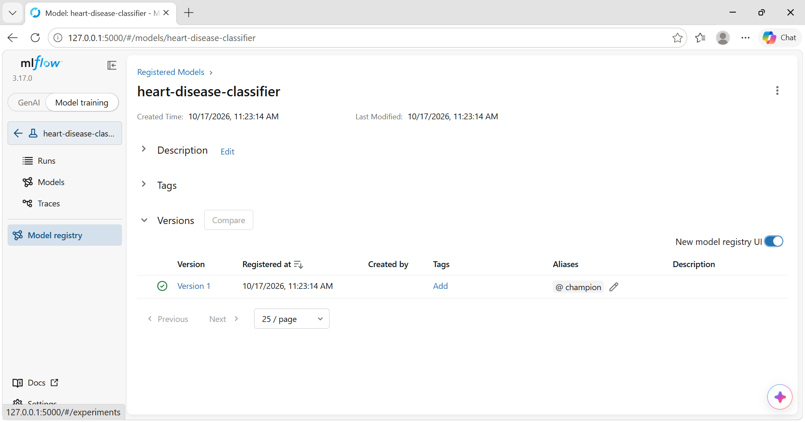

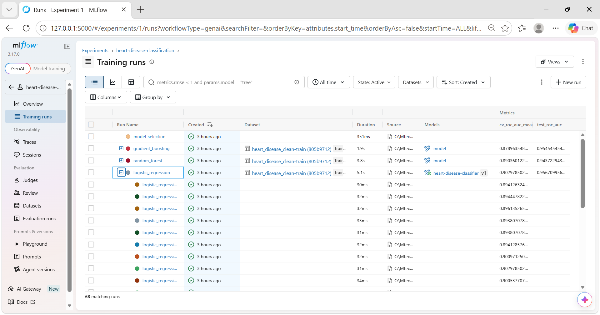{width=5.2}

## 7. Packaging and reproducibility

* **Installable package:** the code is installed with `pip install -e .` (configured in `pyproject.toml`).
* **Two pinned requirement sets:**
  * `requirements.txt` – the full development environment.
  * `requirements-serve.txt` – the minimal runtime used by Docker and the MLflow model.
* **The model:**
  * `models/model.joblib` is the complete pipeline, including preprocessing.
  * `metadata.json` records the version, parameters, metrics, features, threshold, MLflow run id, data hash and library versions.
  * The same model is also saved in MLflow format.
* **Fixed randomness:** `random_state=42` is used throughout.
* **Same steps everywhere:** CI runs the exact four commands from Section 3, so a clean checkout reproduces every artifact.

## 8. CI/CD pipeline and automated testing

**Tests.** There are 42 pytest tests, covering 78 % of the code. They cover:

* data cleaning rules;
* feature formulas and imputation;
* model training and the prediction contract;
* an end-to-end training run against a temporary MLflow store;
* the API: valid prediction, 422 on invalid input, and the `/metrics` and `/health` endpoints.

**Workflow** (`.github/workflows/ci-cd.yml`). It runs on every push and pull request to `main`. The jobs run in sequence, and a failure stops all later jobs.

| Job | What it does | Artifacts |
|---|---|---|
| lint | `ruff check`, `ruff format --check` | – |
| test | pytest + coverage; results in the run summary | `test-reports` |
| train | download → clean → EDA → train; **quality gate: fails if test ROC-AUC < 0.85**; metrics table in summary | `model`, `mlflow-and-reports` |
| docker | build image, run it, smoke-test `/health` and `/predict`, assert 422 on bad input; push to GHCR on `main` | `docker-smoke-test` |

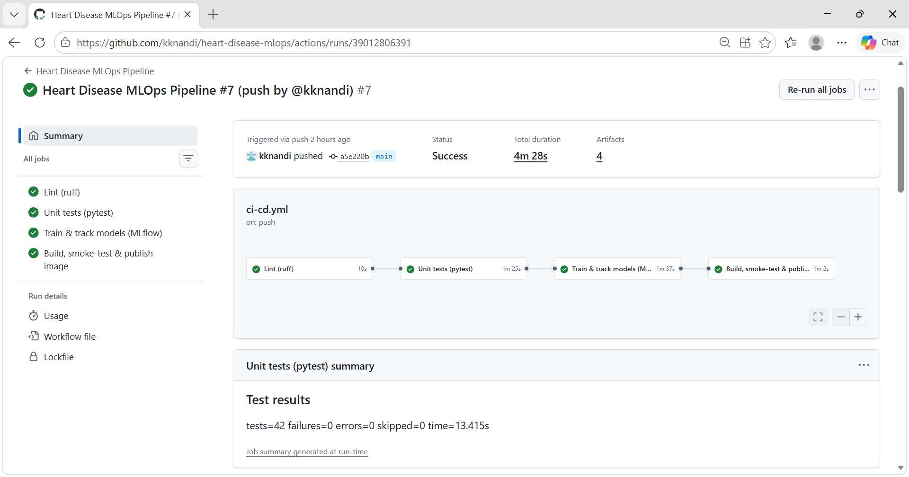{width=6.4}

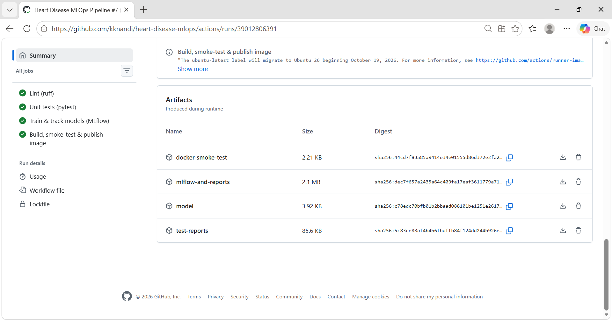{width=5.6 crop=0.315-0.452} 

{width=5.6 crop=0.774-0.928}

## 9. Model containerisation

The FastAPI service exposes these endpoints:

* `POST /predict` takes the 13 attributes as JSON and returns the prediction, label, probability, **confidence**, risk band and model version.
* `GET /health` serves the probes and the Docker health check.
* `GET /model-info` returns the model metadata.
* `GET /metrics` serves Prometheus metrics.
* `/docs` is the Swagger UI.

Pydantic checks every field's type, range and allowed codes, and rejects unknown fields with HTTP 422. Invalid data therefore never reaches the model.

The image is based on `python:3.13-slim`. It contains only the serving requirements and the model files, runs as a non-root user (uid 10001), and has a `HEALTHCHECK` on `/health`.

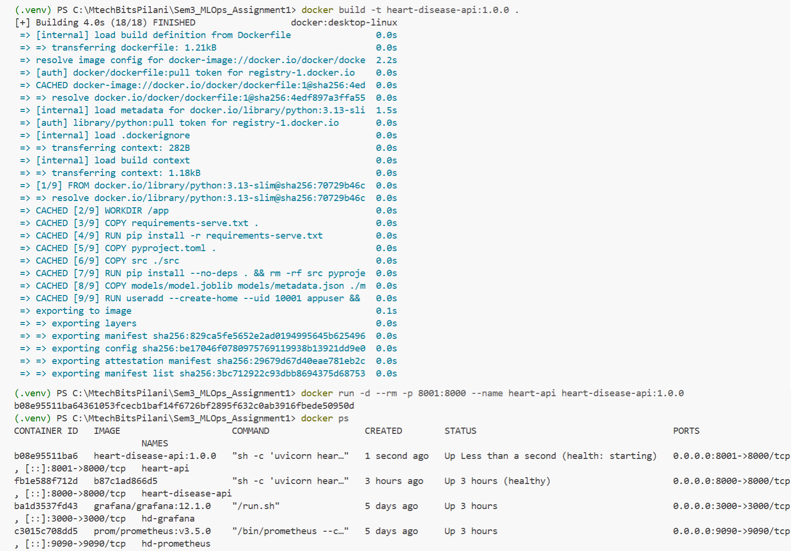{width=5.2}

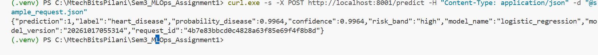{width=6.4}

## 10. Production deployment (Kubernetes)

The manifests in `k8s/` are applied with `kubectl apply -k k8s/` on Docker Desktop Kubernetes. They define:

* a namespace, `heart-disease`;
* a **Deployment** with:
  * **2 replicas** and a rolling update that keeps every pod serving (`maxUnavailable: 0`);
  * **startup, readiness and liveness probes** on `/health`;
  * CPU/memory requests and limits;
  * a non-root, read-only root filesystem with all capabilities dropped;
* a **LoadBalancer Service** on port 8080;
* an optional nginx **Ingress** (`heart-disease.localtest.me`).

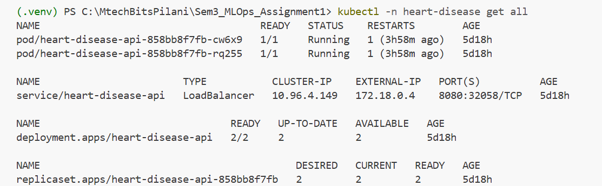{width=5.6}

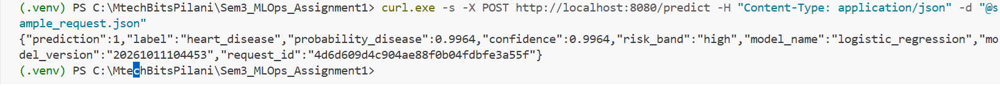{width=6.4}

## 11. Monitoring and logging

**Logging.** Every request produces one JSON log line with the request id (`X-Request-ID`), method, path, status and latency. Prediction lines also carry the label and probability. Patient features are never logged.

**Metrics** (`/metrics`): request count by endpoint and status, a latency histogram, in-flight requests, predictions by class, a predicted-probability histogram (a drift signal), inference errors, and a model-loaded flag.

**Dashboard.** `docker compose up` starts Prometheus, which scrapes both the Compose API and the Kubernetes service every 5 seconds, and Grafana. Grafana has a provisioned 10-panel dashboard showing requests per second, p50/p95/p99 latency, 4xx/5xx rates, the class mix and the mean probability. `scripts/generate_traffic.py` replays real patients and injects about 10 % invalid requests.

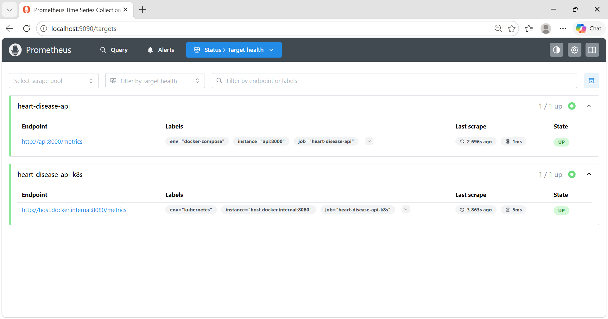{width=5.6 crop=0.0-0.71}

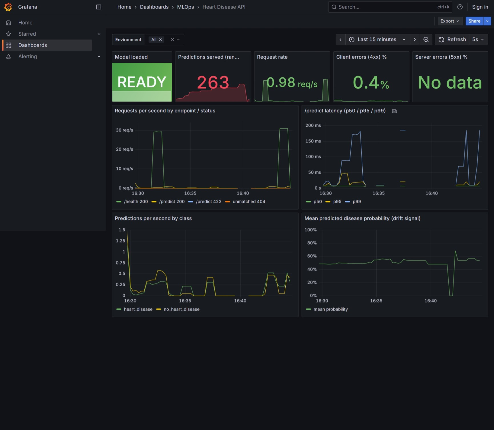{width=4.6}

## 12. Conclusion and future work

Raw UCI data becomes a tested, tracked, containerised and monitored model on Kubernetes, and each push re-validates the whole chain automatically. The interpretable champion reaches 0.957 test ROC-AUC with 93 % recall.

Next steps:

* external validation on the Hungarian, Swiss and VA subsets;
* probability calibration, and a decision threshold agreed with clinicians;
* input-drift alerts in Prometheus Alertmanager;
* GitOps deployment to a cloud cluster;
* scheduled retraining that promotes a new model only if it beats `@champion`.
